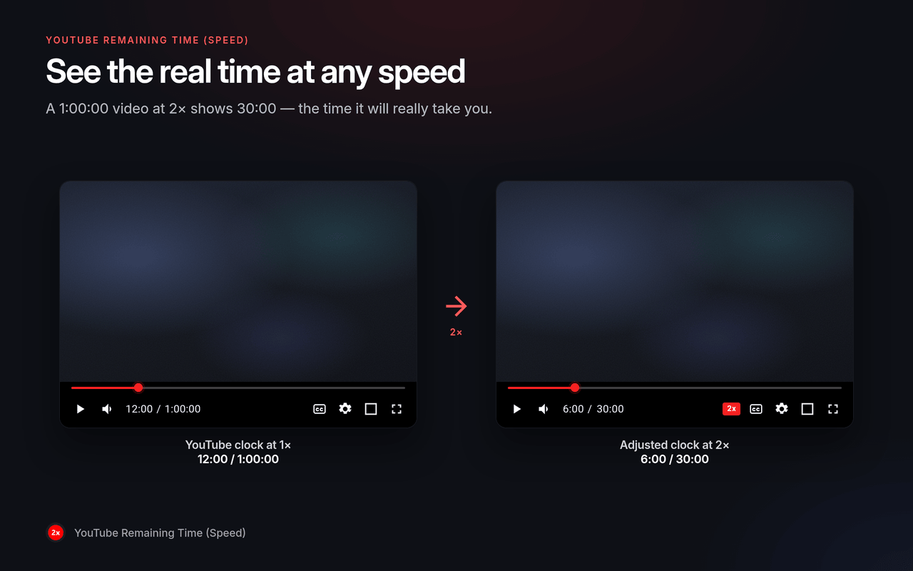
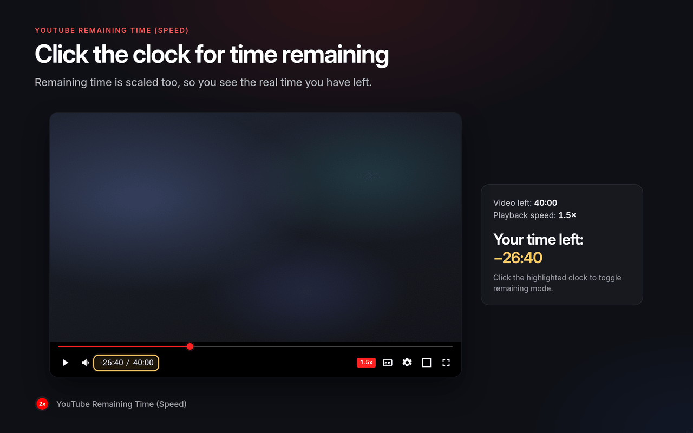
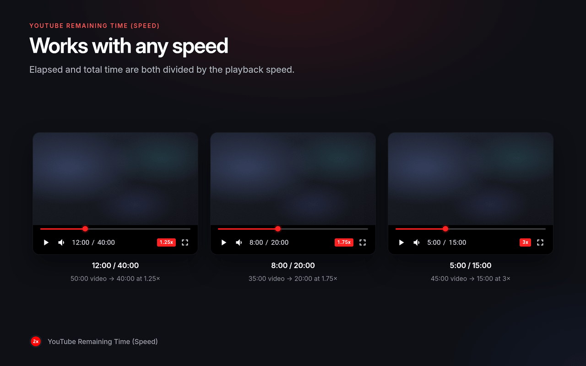
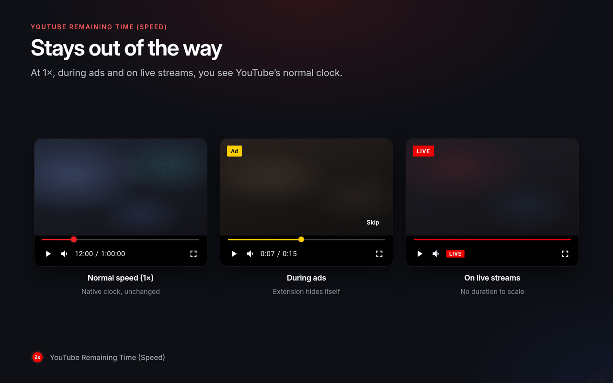
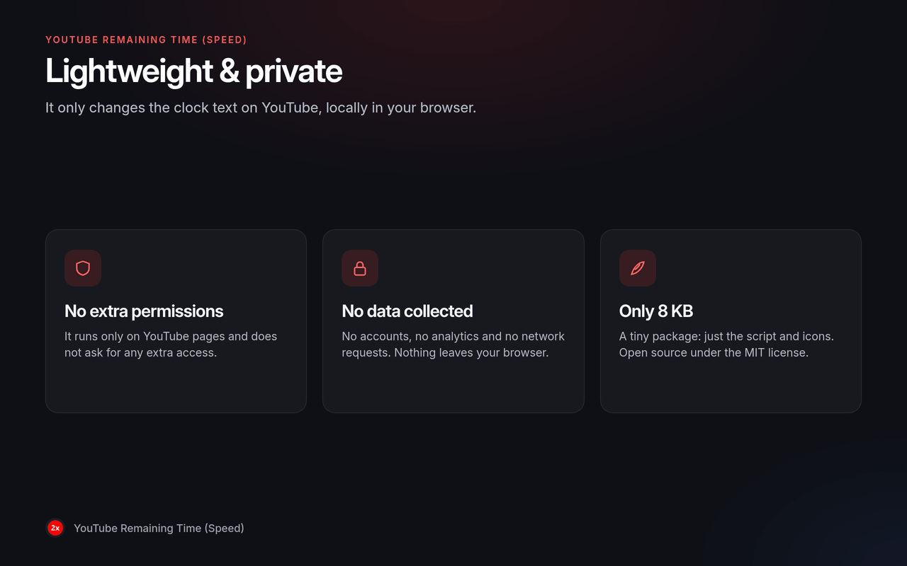

# YouTube Remaining Time (Speed)

[](https://chromewebstore.google.com/detail/youtube-remaining-time-sp/aeiiffihjecajlabfllkkoenldfnamha)
[](LICENSE)

Chrome extension that scales **both** YouTube player times by playback speed, so the clock shows how long a video will really take you.

```text
left  (current)  = currentTime ÷ playback rate
right (duration) = duration ÷ playback rate
```

**Example at 2×:** media `12:39 / 26:00` shows as `6:19 / 13:00`.

If you click the clock into remaining mode (`-M:SS`), the left value is wall-clock remaining at the current speed.



## Features

- **Scaled elapsed and duration** — both sides of the player clock are divided by the current playback speed.
- **Remaining mode** — click YouTube’s clock to switch to remaining time (`-M:SS`); that value is scaled too, so it is the real time you have left.
- **Any speed** — works at 1.25×, 1.5×, 2×, 3× and any other rate YouTube offers.
- **Stays out of the way** — at 1×, during ads and on live streams, YouTube’s native clock is restored.
- **Miniplayer and SPA navigation** — rebinds when you switch videos without reloading, and keeps working in the miniplayer.
- **Accessible labels** — screen readers can read the adjusted times, with a note that they are adjusted for the current speed.
- **No extra permissions and no data collection** — content script on YouTube only; no analytics, no network requests, no remote code.

## Screenshots

**Remaining mode** — click the clock to see time left at the current speed (`-26:40 / 40:00` at 1.5×).



**Any speed** — elapsed and total are both divided by the playback rate.



**Stays out of the way** — at 1×, during ads and on live streams you see YouTube’s normal clock.



**Lightweight and private** — it only changes the clock text on YouTube, locally in your browser.



A 440×280 promotional tile is in [`docs/screenshots/promo-440x280.png`](docs/screenshots/promo-440x280.png).

## Install

### Chrome Web Store (recommended)

Install it from the [Chrome Web Store listing](https://chromewebstore.google.com/detail/youtube-remaining-time-sp/aeiiffihjecajlabfllkkoenldfnamha).

### From source (load unpacked)

1. Clone this repository:
   ```bash
   git clone https://github.com/joelng25/youtube-remaining-time-speed.git
   cd youtube-remaining-time-speed
   ```
2. Open `chrome://extensions`
3. Enable **Developer mode**
4. Click **Load unpacked** and select this folder
5. Reload any open YouTube tabs

## Optional: Enhancer for YouTube

Prefer a userscript? Paste [`custom-script.js`](custom-script.js) into Enhancer’s **Custom script** and enable auto-execute. `custom-script.js` is generated from `content.js` (`npm run build:userscript`); do not edit it by hand. Do not run the extension and the custom script at the same time.

## How it works

| Speed | Left (current) | Right (duration) |
| --- | --- | --- |
| 1× | Normal elapsed | Normal total |
| 1.5× | Elapsed ÷ 1.5 | Duration ÷ 1.5 |
| 2× | Elapsed ÷ 2 | Duration ÷ 2 |

The name includes remaining time because clicking YouTube's clock enables that mode. By default both elapsed and total duration are scaled. The extension hides native clock text and adds separate sibling labels rather than rewriting YouTube nodes. At normal speed, during ads and on live streams it restores the native clock. SPA navigation rebinds the new player and removes labels from the previous player.

Updates are event-driven: the labels are redrawn on the video's `timeupdate`, `seeked`, `ratechange`, `play`/`pause` and metadata events, so nothing runs while a video is paused. Mutation observers watch only the player's `class` attribute (ads, miniplayer, live), the player's parent (player replaced) and the time display (clock re-rendered or switched to remaining mode).

Accessibility: the scaled labels are readable by screen readers, the hidden native times are marked `aria-hidden` while scaling is active, and a visually hidden note announces that the times are adjusted for the current speed.

`content.js` runs automatically as the MV3 extension content script. `custom-script.js` is generated from `content.js` for Enhancer's custom-script feature; it runs only after you paste it and enable auto-execute there. Both perform local DOM updates and make no network requests.

## Development

```bash
npm install
npm test
npm run build:userscript   # regenerates custom-script.js from content.js
npm run package            # also writes dist/youtube-remaining-time-speed-<version>.zip
```

`bun` works as well (`bun install`, `bun run test`, `bun run package`).

Edit `content.js` only; `custom-script.js` is generated from it and a test fails if they drift. After editing `content.js`, run `npm run build:userscript` (or `npm run package`, which does that first).

On Windows, Git’s `core.autocrlf` can convert line endings to CRLF and make that generator check fail, because it compares the two files as raw text. This repo includes a `.gitattributes` file (`* text=auto eol=lf`) so checkouts stay LF and the test stays stable. If you still see a drift failure, run `npm run build:userscript` and avoid committing a CRLF-only change to `custom-script.js`.

## Privacy

No data collection, no analytics, no remote servers.

- [Privacy Policy](https://joelng25.github.io/youtube-remaining-time-speed/privacy-policy.html)

## Project layout

| File | Purpose |
| --- | --- |
| `manifest.json` | Chrome MV3 manifest |
| `content.js` | Extension content script |
| `custom-script.js` | Optional Enhancer for YouTube custom script (generated from `content.js`) |
| `scripts/` | `build-userscript.cjs` (generates `custom-script.js`), `package.cjs` (store ZIP) |
| `tests/` | Player regression tests (happy-dom) |
| `icons/` | Extension icons |
| `docs/screenshots/` | Chrome Web Store screenshots (1280×800) and promo tile (440×280) |
| `store/` | Older single-frame store captures |
| `privacy-policy.html` | Public privacy policy |

## License

MIT — see [LICENSE](LICENSE).
