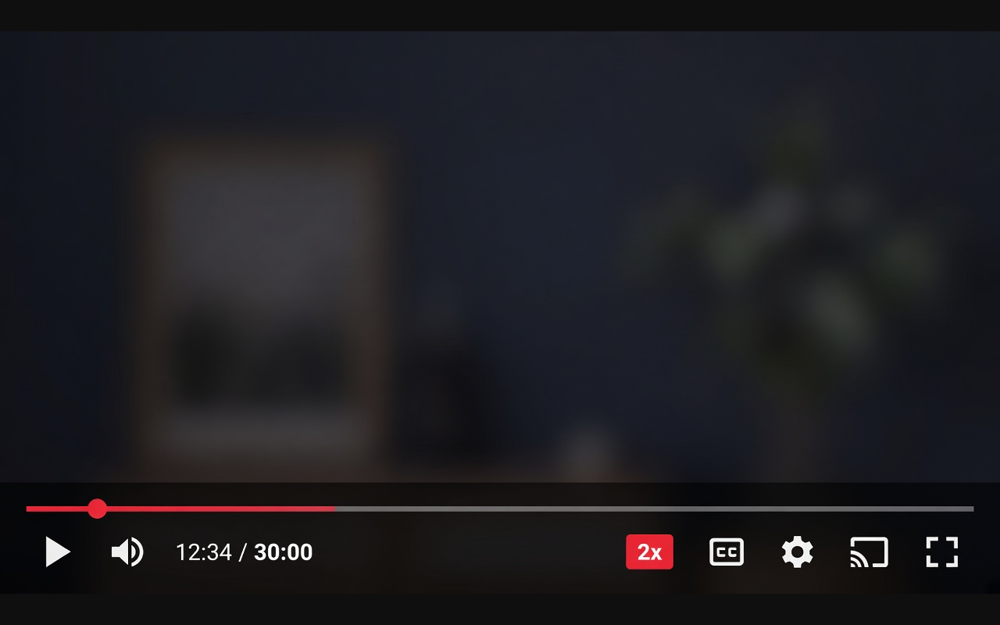

# YouTube Remaining Time (Speed)

Chrome extension that scales **both** YouTube player times by playback speed:

```text
left  (current)  = currentTime ÷ playback rate
right (duration) = duration ÷ playback rate
```

**Example at 2×:** media `12:39 / 26:00` shows as `6:19 / 13:00`.

If you click the clock into remaining mode (`-M:SS`), the left value is wall-clock remaining at the current speed.

[](https://chromewebstore.google.com/detail/youtube-remaining-time-sp/aeiiffihjecajlabfllkkoenldfnamha)
[](LICENSE)



## Install

### Chrome Web Store (recommended)

Install it from the [Chrome Web Store listing](https://chromewebstore.google.com/detail/youtube-remaining-time-sp/aeiiffihjecajlabfllkkoenldfnamha).

### From source

1. Clone this repository:
   ```bash
   git clone https://github.com/joelng25/youtube-remaining-time-speed.git
   cd youtube-remaining-time-speed
   ```
2. Open `chrome://extensions`
3. Enable **Developer mode**
4. Click **Load unpacked** and select this folder
5. Reload any open YouTube tabs

## How it works

| Speed | Left (current) | Right (duration) |
| --- | --- | --- |
| 1× | Normal elapsed | Normal total |
| 1.5× | Elapsed ÷ 1.5 | Duration ÷ 1.5 |
| 2× | Elapsed ÷ 2 | Duration ÷ 2 |

The name includes remaining time because clicking YouTube's clock enables that mode. By default both elapsed and total duration are scaled. The extension hides native clock text and adds separate sibling labels rather than rewriting YouTube nodes. At normal speed, during ads and on live streams it restores the native clock. SPA navigation rebinds the new player and removes labels from the previous player.

Updates are event-driven: the labels are redrawn on the video's `timeupdate`, `seeked`, `ratechange`, `play`/`pause` and metadata events, so nothing runs while a video is paused. Mutation observers watch only the player's `class` attribute (ads, miniplayer, live), the player's parent (player replaced) and the time display (clock re-rendered or switched to remaining mode).

Accessibility: the scaled labels are readable by screen readers, the hidden native times are marked `aria-hidden` while scaling is active, and a visually hidden note announces that the times are adjusted for the current speed.

`content.js` runs automatically as the MV3 extension content script. `custom-script.js` is generated from `content.js` (`npm run build:userscript`) for Enhancer's custom-script feature; it runs only after you paste it and enable auto-execute there. Both perform local DOM updates and make no network requests. Do not enable both at once.

## Privacy

No data collection, no analytics, no remote servers.

- [Privacy Policy](privacy-policy.html)

## Project layout

| File | Purpose |
| --- | --- |
| `manifest.json` | Chrome MV3 manifest |
| `content.js` | Extension content script |
| `custom-script.js` | Optional Enhancer for YouTube custom script (generated from `content.js`) |
| `scripts/` | `build-userscript.cjs` (generates `custom-script.js`), `package.cjs` (store ZIP) |
| `tests/` | Player regression tests (happy-dom) |
| `icons/` | Extension icons |
| `store/` | Chrome Web Store screenshots |
| `privacy-policy.html` | Public privacy policy |

## Development

```bash
bun install            # or: npm install
bun run test           # or: npm test
bun run package        # regenerates custom-script.js and writes dist/youtube-remaining-time-speed-<version>.zip
```

Edit `content.js` only; `custom-script.js` is regenerated from it and a test fails if they drift.

## Optional: Enhancer for YouTube

Prefer a userscript? Paste [`custom-script.js`](custom-script.js) into Enhancer’s **Custom script** and enable auto-execute. Do not run the extension and the custom script at the same time.

## License

MIT — see [LICENSE](LICENSE).
